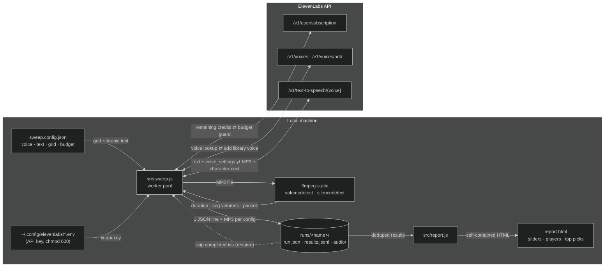
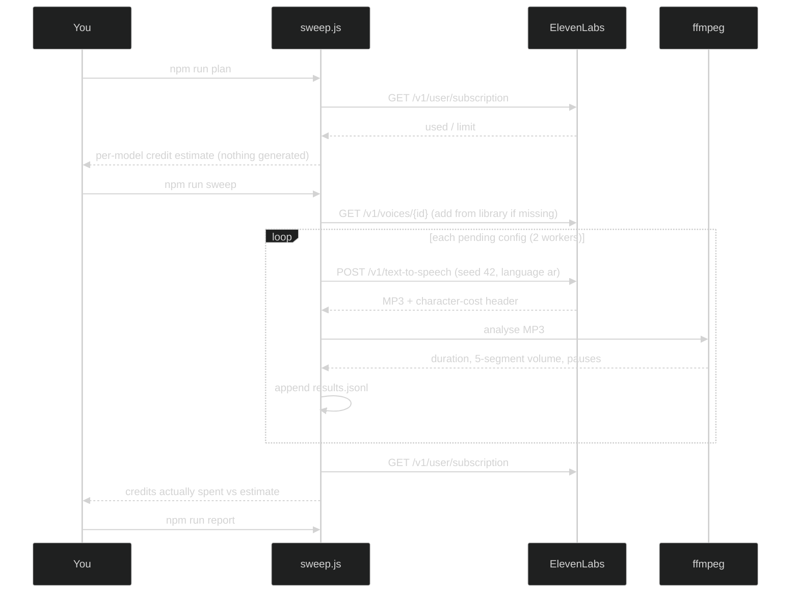

# IILabs Arabic Voice Sweeps

Parameter sweeps for **ElevenLabs Arabic text-to-speech**. Each sweep generates the same Arabic script across a
grid of models × `stability` × `similarity_boost` × `speed`. Every clip is measured with ffmpeg and the results
are published as a self-contained, dark HTML report with sliders and audio players.

The goal is to pick voice settings for Saudi Arabic voice agents (default voice: **Jeddawi**) from measurements
instead of guesswork.

**Live reports (GitHub Pages):** https://m86hussein.github.io/IILabsArabicVoiceSweeps/

## Purpose: what the clips are for

The clips are test samples, not product audio. Each one is the same Arabic Hajj script spoken with different
settings, so the settings can be compared by ear and by measurement. The winning settings are hard-coded into
production: the TTS module (`ttsElevenLabs.js`) that voices Hajj WhatsApp replies.

```mermaid
%%{init: {'theme':'dark', 'themeVariables': {'fontSize':'14px', 'lineColor':'#8b98a5'}}}%%
flowchart TB
    subgraph S1["① Sweep: generate test clips"]
        TXT["Arabic Hajj script<br/>same text for every clip"]
        GRID["Settings grid<br/>model × stability × similarity × speed"]
        EL["ElevenLabs TTS<br/>Jeddawi voice · seed 42"]
        CLIPS[("Test clips<br/>240 MP3 in April · 48 planned in Oct")]
        TXT --> EL
        GRID -- "one voice_settings per clip" --> EL
        EL -- "MP3 per config" --> CLIPS
    end

    subgraph S2["② Evaluate: pick a winner"]
        FF["ffmpeg metrics<br/>chars/s · volume spread · pauses"]
        REP["HTML report on GitHub Pages<br/>sliders · players · scores"]
        EAR["Listen and compare<br/>Saudi naturalness, calm pace"]
        WIN{{"Winning settings<br/>eleven_v3 · stab 0.5 · sim 0.5 · speed 0.85"}}
        FF -- "metrics per clip" --> REP
        REP -- "shortlist" --> EAR
        EAR -- "decision" --> WIN
    end

    subgraph S3["③ Production: Hajj WhatsApp voice replies"]
        PIL(["Pilgrim asks on WhatsApp"])
        BOT["AI reply text<br/>ai-consumer Function"]
        AZ["Azure Speech<br/>primary TTS"]
        TTS["ttsElevenLabs.js<br/>fallback TTS, Jeddawi"]
        BLOB[("Blob storage<br/>reply MP3")]
        ACS["ACS WhatsApp<br/>kind: audio"]
        OUT(["Pilgrim hears voice note"])
        PIL -- "question" --> BOT
        BOT -- "Arabic text" --> AZ
        AZ -. "on failure" .-> TTS
        AZ -- "audio" --> BLOB
        TTS -- "MP3 192 kbps" --> BLOB
        BLOB -- "mediaUri" --> ACS
        ACS -- "voice note" --> OUT
    end

    CLIPS -- "MP3 files" --> FF
    CLIPS -- "audio players" --> REP
    WIN == "hard-coded constants" ==> TTS

    classDef gen fill:#1f2a3a,stroke:#4ea1ff,color:#e6edf3
    classDef eval fill:#2a2238,stroke:#b388ff,color:#e6edf3
    classDef prod fill:#1d2e25,stroke:#3fb950,color:#e6edf3
    classDef win fill:#3a2f12,stroke:#f2cc60,color:#fff3c4,stroke-width:2px
    class TXT,GRID,EL,CLIPS gen
    class FF,REP,EAR eval
    class PIL,BOT,AZ,TTS,BLOB,ACS,OUT prod
    class WIN win
    style S1 fill:#0f1620,stroke:#4ea1ff
    style S2 fill:#15111d,stroke:#b388ff
    style S3 fill:#0f1a14,stroke:#3fb950
```



| Step | What happens | Output |
|---|---|---|
| ① Sweep | The same script is spoken with every combination of settings | MP3 clips + `results.jsonl` |
| ② Evaluate | ffmpeg measures each clip. You listen in the report and pick the steadiest, most natural setting | Winning settings |
| ③ Production | The winner becomes the constants in `ttsElevenLabs.js`, which voices WhatsApp replies to pilgrims when Azure Speech fails | Voice notes to users |

The October `2026-10-jeddawi` sweep re-checks this choice with the shorter 167-char script.

## Architecture





## How to use

### Browse the results (no setup)

1. Open https://m86hussein.github.io/IILabsArabicVoiceSweeps/ and pick a run.
2. Check **Top Picks** for the slowest (calmest), most consistent, best balanced and fastest-to-generate clip.
3. Narrow the grid with the **model** buttons and the **stability / similarity / speed** sliders (far left = ALL).
   Use **Sort by** to rank by speaking rate, volume consistency, balanced score, pauses or generation time.
4. Press **play** on any row to hear that clip. Every clip speaks the same text, so the only difference you hear
   is the settings.
5. Copy the winning `model · stability · similarity · speed` into your own TTS call.

### Run your own sweep

Requirements: Node 20+ and an ElevenLabs API key. The free tier is enough for the default 48-clip grid.

```bash
git clone https://github.com/m86hussein/IILabsArabicVoiceSweeps.git
cd IILabsArabicVoiceSweeps
npm install                # pulls a static ffmpeg build; no system ffmpeg needed

# API key: keep it OUTSIDE the repo
mkdir -p ~/.config/elevenlabs
echo 'ELEVENLABS_API_KEY=your-key-here' > ~/.config/elevenlabs/elevenlabs.env
chmod 600 ~/.config/elevenlabs/elevenlabs.env

# edit sweep.config.json: runName, voice, text, models, grid, budget
npm run plan               # dry run: grid size, credit estimate vs remaining quota (no credits used)
npm run sweep -- --limit 1 # smoke test: one clip
npm run sweep              # the rest of the grid (resumable; re-run to continue)
npm run report             # runs/<runName>/report.html + runs/index.html
```

The key is read from `ELEVENLABS_API_KEY`, or from the file named in `ELEVENLABS_ENV_FILE`
(default `~/.config/elevenlabs/elevenlabs.env`). See [.env.example](.env.example).

Flags: `--config <file>`, `--dry-run`, `--limit N` (run only the first N pending configs).

### Publish

```bash
git add runs && git commit -m "Add run <runName>" && git push
```

The push triggers [.github/workflows/pages.yml](.github/workflows/pages.yml), which deploys `runs/` to GitHub
Pages. The new run appears on the index page a minute later.

### Keeping secrets out

- The API key is never written to the repo. `.env` and `.env.*` are git-ignored (only `.env.example` is tracked).
- Run output contains only settings, metrics and MP3s. There are no keys, account IDs or request headers.
- GitHub secret scanning with push protection is on, so a push that contains a recognised key is blocked.

## Credit budget

ElevenLabs bills TTS per character. The free tier allows **10,000 credits/month** and 2 concurrent requests.

| Item | Value |
|---|---|
| Default text | 167 chars / 31 words (Hajj intro, MSA) |
| Default grid | 3 models × 4 stability × 2 similarity × 2 speed = **48 clips** |
| Estimate | 48 × 167 = **8,016 credits** (worst case, multiplier 1.0 for every model) |
| Reserve | 500 credits kept untouched (`budget.reserveCredits`) |

The **budget guard** refuses to start when the estimate exceeds the remaining quota minus the reserve. Generation
also stops immediately on quota, payment or auth errors, so the rest of the grid isn't wasted. Flash/Turbo models
may bill 0.5 credits per character. Set `creditMultiplier` per model once you've confirmed this from the
`creditsCharged` field or the before/after spend printed at the end of a run.

For reference, the April baseline (424-char text, 240 clips) needs 85–102K credits, depending on how Flash is billed.

## Metrics

| Metric | How | Lower is… |
|---|---|---|
| `charsPerSec` | chars ÷ speech time (pauses excluded) | slower, calmer delivery |
| `volSpreadDb` | max − min mean volume across 5 equal segments | more even loudness |
| `pauseCount` / `pauseTotalSec` | `silencedetect=n=-35dB:d=0.2` | fewer / shorter gaps |
| `genTimeMs` | request latency | faster generation |
| Balanced score | `charsPerSec + 5 × volSpreadDb` | best all-round |

## Runs

| Run | Clips | Notes |
|---|---|---|
| [2026-04-baseline](https://m86hussein.github.io/IILabsArabicVoiceSweeps/2026-04-baseline/report.html) | 240 | 424-char text, 3 models × 5 stability × 4 similarity × 4 speed |
| `2026-10-jeddawi` | 48 | Default config (pending) |

**Baseline findings (April):**

| Model | Avg chars/s | Avg vol spread | Avg gen time |
|---|---|---|---|
| `eleven_flash_v2_5` | **10.8** (slowest delivery) | 1.4 dB | **1.4 s** |
| `eleven_multilingual_v2` | 14.3 | 2.0 dB | 5.6 s |
| `eleven_v3` | 12.4 | **0.9 dB** (most even) | 6.1 s |

- Best balanced: `flash_v2_5 · stability 0.5 · similarity 0.5 · speed 0.7`
- Most consistent: `v3 · stability 0.5 · similarity 0.5 · speed 0.85`

## Hosting

Everything lives on GitHub: code, results, MP3s (about 1.1 MB each) and the reports. GitHub Pages serves
`runs/` as a static site, so there is no server, database or cloud account to run.

## Layout

```
sweep.config.json        voice, Arabic text, model list, grid, budget
src/sweep.js             generation + ffmpeg analysis + budget guard + resume
src/report.js            HTML report generator
runs/<name>/run.json     frozen config of the run
runs/<name>/results.jsonl  one JSON line per attempt (last line per id wins)
runs/<name>/audio/       MP3 per config
runs/<name>/report.html  generated report
runs/index.html          list of runs (GitHub Pages home page)
.github/workflows/pages.yml  deploys runs/ to GitHub Pages on every push to main
```
